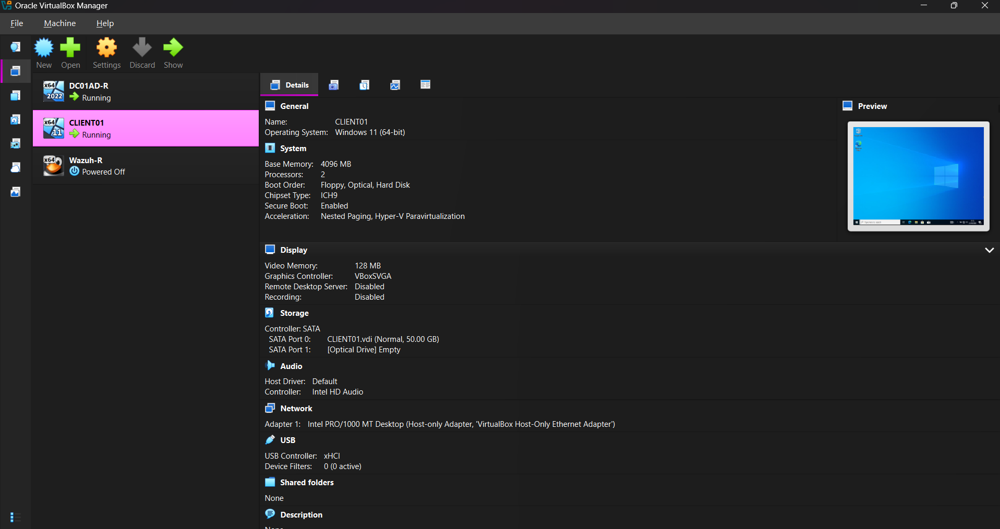
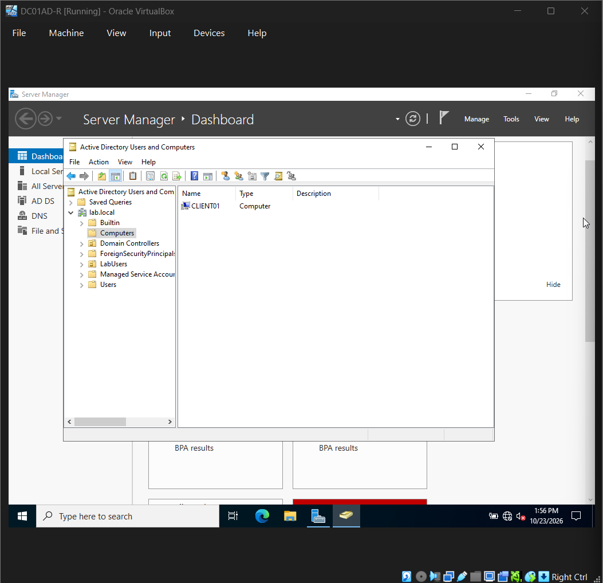
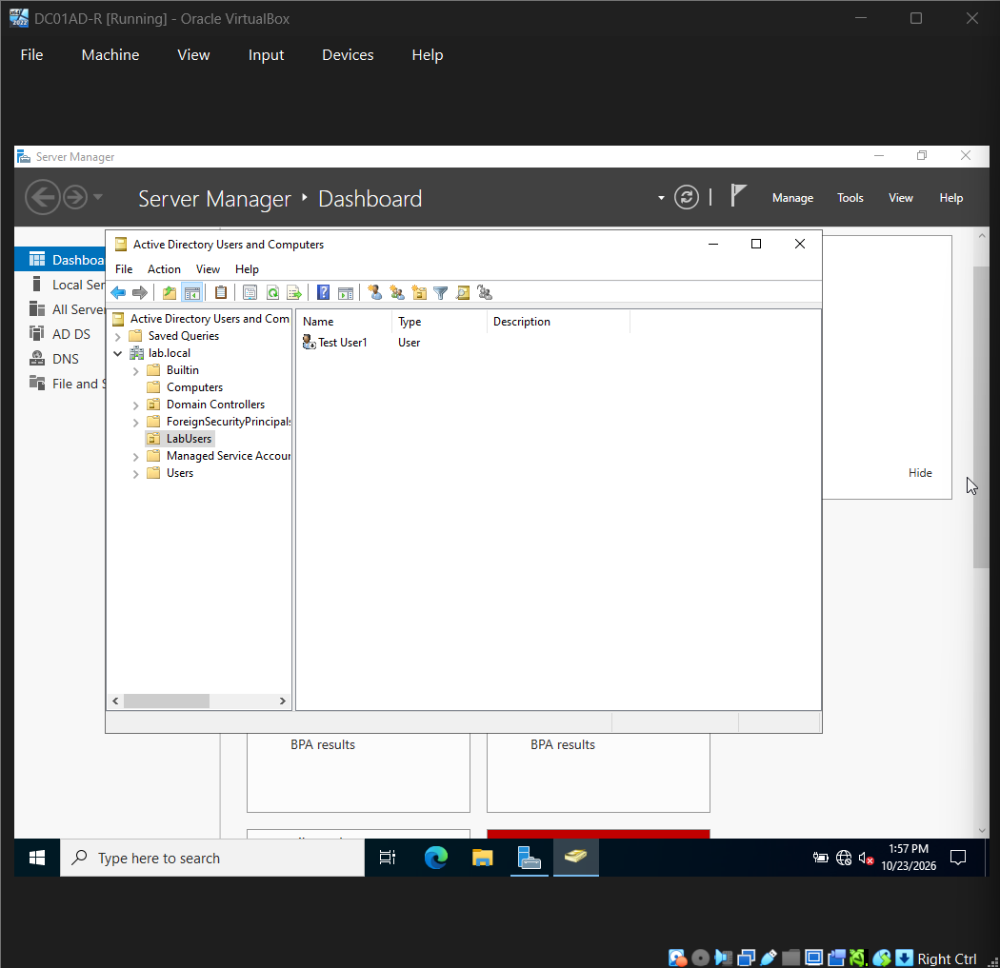
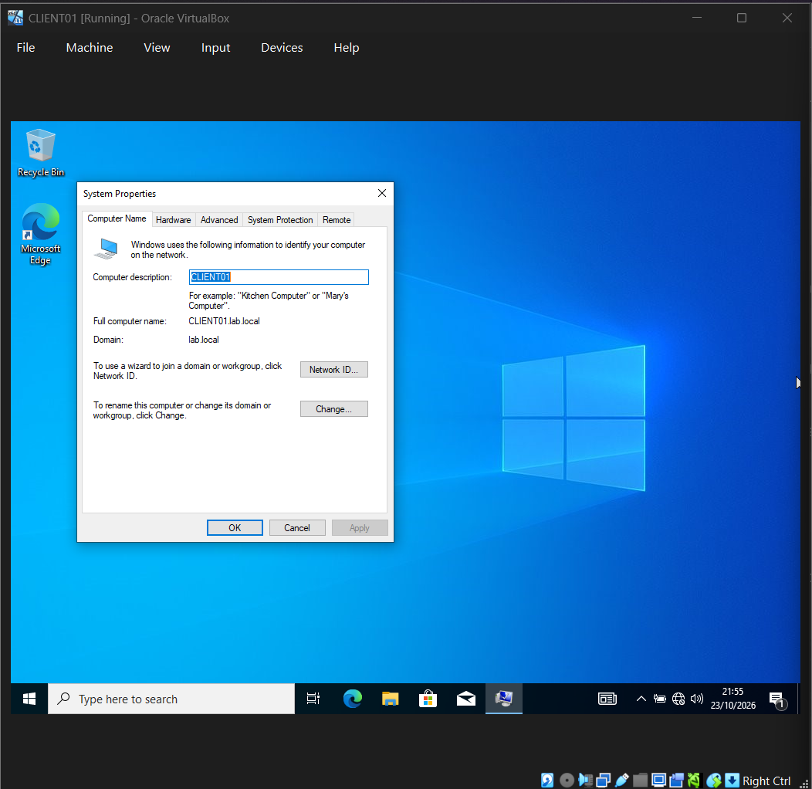
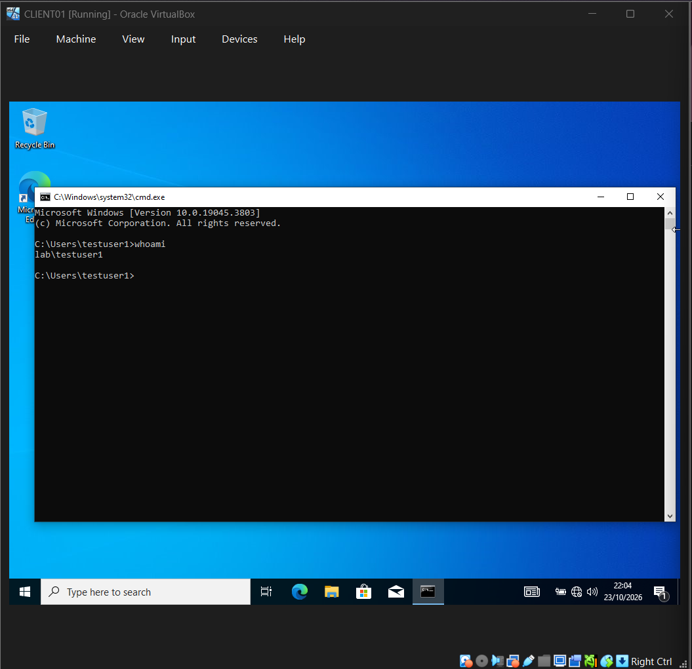

# Active Directory Identity Threat Detection Lab

A security lab I built from scratch to understand how Active Directory actually works, and more to the point, how it gets attacked. It's a small Windows domain with a SIEM (Wazuh) watching over it, and the whole idea is to run real attacks like Kerberoasting and then catch them in the logs.

**Status:** 🟡 In progress. The core infrastructure is built and verified (domain, domain-joined client, working authentication). The detection side (agents, attack, alerts) is what I'm doing next. See the Roadmap near the bottom.

## Overview

I wanted to stop just reading about Active Directory attacks and actually watch one happen in front of me. So I built a miniature corporate network: a Windows Server 2022 domain controller, a Windows 10 machine joined to the domain, and a Wazuh SIEM pulling logs from both.

Standing the network up is only half the job. The part I actually care about is generating a real attack (starting with Kerberoasting) and then proving I can spot it in the logs afterwards. That detection step is the whole reason this lab exists.

I'm a second-year Cyber Security student building this toward a placement year, so it also works as a running record of what I've learned, including the things that went sideways. And plenty did.

## Why I built it

- To understand how enterprise identity really works, and therefore how it breaks, instead of just memorising terms for a module.
- To practise the actual blue-team loop: collect the logs, figure out what "normal" looks like, then catch the thing that isn't normal.
- To have a project I can genuinely talk through in an interview, including the parts that broke and how I got them working again.

## Architecture

All three machines sit on an isolated VirtualBox host-only network (192.168.1.0/24), so none of the lab traffic (including anything malicious) ever touches my real network.

```
                 Host-only network  192.168.1.0/24  (isolated)
     ┌─────────────────────────┬──────────────────────────┐
     │                         │                          │
┌────┴─────────┐      ┌────────┴────────┐        ┌────────┴────────┐
│   DC01       │      │   CLIENT01      │        │   WAZUH          │
│ Win Server   │      │ Windows 10 Pro  │        │ Wazuh 4.14.7     │
│   2022       │      │ domain member   │        │ SIEM manager     │
│ AD DS + DNS  │      │ CLIENT01.lab... │        │ + dashboard      │
│ 192.168.1.10 │      │ 192.168.1.20    │        │ 192.168.1.x      │
└──────────────┘      └─────────────────┘        └─────────────────┘
  domain: lab.local      logs ───────────────────────▶ (Wazuh agent)
```



## Environment

| Machine   | OS                       | Role                          | IP            |
|-----------|--------------------------|-------------------------------|---------------|
| DC01      | Windows Server 2022      | Domain Controller, AD DS, DNS | 192.168.1.10  |
| CLIENT01  | Windows 10 Pro           | Domain-joined workstation     | 192.168.1.20  |
| WAZUH     | Wazuh OVA 4.14.7 (Linux) | SIEM manager + dashboard      | 192.168.1.x   |

- **Domain:** lab.local
- **Virtualisation:** Oracle VirtualBox, host-only networking
- **Storage:** the VMs run from an external SSD so they don't eat my host disk

## What I built

### 1. The domain controller (DC01)

I installed Windows Server 2022 and promoted it to a domain controller for a new domain, lab.local. Then I created an Organizational Unit called LabUsers and added a test user, testuser1, through Active Directory Users and Computers.



### 2. The isolated network

I moved every VM onto a host-only adapter so the whole thing is sealed off and safe to attack. DC01 has a static IP (192.168.1.10) and runs DNS for the domain.

### 3. The client machine (CLIENT01)

I installed Windows 10 Pro, since Home can't join a domain (I found that out the slightly annoying way). I gave it a static IP (192.168.1.20) and, importantly, pointed its DNS at the DC. That DNS setting is the thing that lets the client actually find and join lab.local. Then I joined it to the domain and checked it had landed properly from the server side.





### 4. Proving it actually works end to end

I confirmed the client could reach the DC and resolve the domain (a ping to the DC, plus nslookup lab.local coming back as 192.168.1.10). Then I logged into CLIENT01 as a real domain user, LAB\testuser1, and ran whoami to prove the authentication flows all the way through.



### 5. The SIEM (Wazuh), coming up next

The Wazuh manager and dashboard are deployed. Next I'll get agents and Sysmon onto DC01 and CLIENT01, so their authentication and process activity actually flow into the SIEM where I can work with them.

## What's next: the detection phase

1. **Baseline.** Log in and out as testuser1 so I know what normal authentication looks like (Windows Event ID 4624).
2. **Attack.** Run Kerberoasting from CLIENT01. It requests service tickets that can be cracked offline to recover credentials, and it's one of the most common real-world AD attacks going.
3. **Detect.** Find it in Wazuh through the service-ticket requests it leaves behind (Event ID 4769) and the alerts they set off.

## Troubleshooting log

Honestly this is my favourite section, because the debugging is where I actually learned the most. Every one of these cost me time and taught me something.

**All my VMs suddenly showed up as "Inaccessible" after I unplugged the SSD without ejecting it.** It turned out the small .vbox config files had been wiped to zero, but the big .vdi disk images (the actual data) were completely fine. I rebuilt the VM shells pointing at the existing disks, and learned along the way that .vbox-prev is VirtualBox's automatic config backup. I also had to match the new VM's MAC address to the old one so the DC kept its static IP. Lesson well and truly learned: eject the drive properly.

**The Windows 11 client install just hung on a black screen, indefinitely.** The VM settings were all correct (ICH9, TPM, Secure Boot), so it took me a while to find the real cause: my laptop's own Hyper-V was interfering with VirtualBox's EFI boot. BIOS-mode VMs booted fine, EFI ones didn't. Rather than tear apart my whole host setup, I switched the client to a BIOS-mode Windows 10 build and moved on.

**The install then failed over and over with 0x800701B1 and 0x80070015 ("device not ready").** My external SSD kept dropping its USB connection partway through, because Windows was power-saving the port under load. I disabled USB selective suspend and the disk idle timeout, switched to a more stable port, and it finally went through. I also learned the hard way not to eject the install ISO mid-install, because Windows is still reading from it during the "Getting files ready" stage. Whoops.

**The domain join kept rejecting my password even though it was definitely right.** I ruled out the clock and DNS (the DC was reachable and the domain resolved). The real culprit was a keyboard layout mismatch: the admin password had an @ in it, and @ and " swap places between US and UK layouts, so the password I was "correctly" typing on the client didn't match what was stored. I reset the account to a password with no layout-sensitive characters and it joined straight away. Probably the most frustrating and the most memorable fix of the whole build.

**Then the domain login told me the account was disabled.** testuser1 was simply disabled in AD. I enabled it in ADUC and cleared the "must change password at next logon" flag. Small thing, but a good reminder that account state in AD directly controls whether you can log in at all.

## What I've taken from it so far

- Why DNS has to point at the domain controller, or domain membership just won't work in the first place.
- How much of "it won't authenticate" comes down to boring fundamentals (the clock, DNS, account state, even keyboard layout) rather than whatever dramatic thing you first assume it is.
- More to come once the detection phase is done: how Kerberoasting actually works at the ticket level, what a 4769 event looks like in practice, and how Wazuh rules map onto Windows events.

## Roadmap

- [x] Build DC01 and the lab.local domain
- [x] Isolate the lab on a host-only network
- [x] Build and domain-join CLIENT01
- [x] Verify domain authentication (domain user login on the client)
- [ ] Deploy Wazuh agents + Sysmon on DC01 and CLIENT01
- [ ] Capture a normal authentication baseline
- [ ] Simulate a Kerberoasting attack
- [ ] Detect it in Wazuh and document the alert
- [ ] Add Group Policy hardening and re-test

## A note on the shortcuts I took

This is a learning lab, not a production network, so a few things are deliberately kept simple: the accounts share easy passwords, it's one flat network, and there's no patching or backups. I'm flagging that on purpose so it's clear these were choices I made, not things I overlooked.
